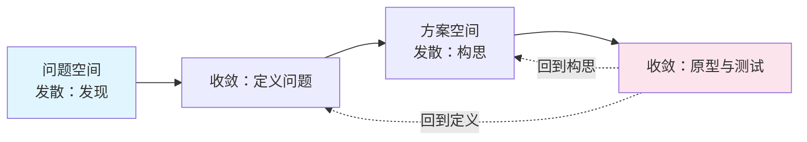

## 概念：设计思维

> 设计思维不是一种新的认知模式，是把「发散—收敛」的切换排成固定节拍（共情 → 定义 → 构思 → 原型 → 测试），并给每一步指定一个可验收的产物。它真正管的是顺序，不是想法。

**解决的核心痛点**：项目失败的大头不是方案做得差，是解错了题——在还没弄清问题是什么的时候，就开始做方案。设计思维用「定义」这道独立关卡把问题与解分开，让方案有一个共同的评判标准。

### 核心命题

- 它唯一的不可替代之处，是把「问题定义」当成一个有产物的独立阶段
	- **原理**：没有这道关卡，团队会在各自假设的不同问题上争论方案，谁也说服不了谁，因为争的不是同一个问题。一旦写成一句问题陈述，「我们不做哪些」也跟着被划出来，方案从此有了共同的验收面
- 它是工序的排程，不是第五种思维方式
	- **原理**：五个阶段只是四条轴上的取值切换——共情是换信息源，构思是发散，测试是质检。它不提供新的认知能力，只规定切轴的时机。把它当认知模式用，会得到一个走完全程却没有结论的工作坊
- 它隐含「试错便宜」这个前提，迭代成本决定适不适用
	- **原理**：原型要能在一周内做出来、被真实用户用坏，五个阶段才转得动。硬件、基建、受监管行业的迭代周期以年计，走完两轮的时间成本高过把一次做对
- 流程不能替代领域知识
	- **原理**：共情能发现问题，方案的好坏取决于对材料、工艺、约束的理解。流程保证「不错过步骤」，不保证「想出好东西」——这是它最常被误解的一处

### 运行机制

五个阶段各有产物与退出判据，没有产物的阶段等于没做：

| 阶段 | 做什么 | 产物（可验收物） | 退出判据 |
|:--|:--|:--|:--|
| 共情 | 观察真实用户的实际行为，而不是问他们想要什么 | 用户旅程地图、观察记录 | 能说出用户现在用什么办法凑合 |
| 定义 | 把观察收敛成一句问题陈述 | POV 陈述 + 「我们不做」清单 | 团队对「要解决什么」说同一句话 |
| 构思 | 发散，数量优先，推迟判断 | 草图集合（如 Crazy 8s 的八格） | 新想法开始重复已有类别 |
| 原型 | 用最低成本做出一个能被否定的东西 | 可点击原型、纸模、可运行的丑版本 | 不用解释就能被使用 |
| 测试 | 看真实用户怎么用，记录失败 | 测试记录 + 待改清单 | 有一批明确的、能改的失败 |

图里两条虚线是它区别于瀑布流程的地方：测试失败时可以退回构思，也可以一路退回到重新定义问题。实线只有一条路，虚线才是它真正的用法。

关于系谱：这个双菱形由英国设计委员会（Design Council）在 2003 年做内部研究时画出，2004 年起对外分享，四个阶段的名字是为了好记而刻意押的头韵。常被引用的「2005」出自 2007 年的 Eleven Lessons 报告，那篇报告是用它去分析十一家企业的做法，不是它的诞生年份。发散—收敛这个形状本身更早，可以追到 1950—60 年代 Osborn 与 Parnes 的创造性解题模型。

### 关键区别

| | 设计思维 | 瀑布流程 | 科学方法 |
|:--|:--|:--|:--|
| 顺序 | 问题 → 方案，可回退 | 需求 → 设计 → 实现，单向 | 假设 → 实验 → 结论 |
| 如何处理「题错了」 | 有独立关卡，可退回重定义 | 无，需求错了一路错到底 | 假设错了可重设 |
| 产物 | 用户可观察的证据 | 文档 | 数据 |
| 前提 | 试错便宜 | 需求稳定 | 可重复实验 |

### 适用范围

- ✅ **适用场景**
	- **需求本身不清楚**：用户说「我想要更快」，快在哪里需要观察才知道
	- **用户行为可观察**：有真实使用者、能接触到、能看到他们怎么凑合
	- **试错便宜**：软件界面、服务流程、内部工具，改一版的成本低于一轮调研
- ⛔ **误用**
	- **仪式化（工作坊剧场）**：五个阶段都走了，便利贴贴满墙，产出物齐全，但没有任何一个决策被改变
	- **用共情替代调研**：五个用户的访谈被当成需求真相，样本偏差被「共情」这个词盖住了
	- **在迭代成本高的领域硬套**：把一年的迭代周期切成五个阶段，实际只是把瀑布换了个名字
	- **跳过定义**：直接进构思，因为构思好玩、定义难。这一跳恰好跳过了它唯一不可替代的部分
- **失效边界**
	- **用户说不出的需求它拿不到**：共情只能观察到已经发生的行为，无法发现用户没见过的可能
	- **不解决分配问题**：谁的需求优先，流程不给答案，由组织权力决定
	- **不保证方案质量**：它降低「解错题」的概率，不提高「解题」的水平

### 批判

- **外部批判**
	- Iskander（《哈佛商业评论》2018）：设计思维本质上是保守的。它把设计者的主观理解当成唯一的转译通道，用户只被允许在既定框架内表达；而且它把解决问题的政治性包装成技术性或审美性，最终方案倾向于维持现状
	- Vinsel（2018）：它给学生「创造性自信而没有实际能力」——以为在解决真实问题，实际没获得任何专业判断力
	- Natasha Jen（Pentagram，2017）：设计思维把常识包装成方法论，用流程的完整感替代思考的严格性
- **内在张力**
	- 它的价值来自「强制放慢到定义阶段」，它的流行却来自「看起来很快能上手」。这两个属性互相拉扯：越是被当作快速解法的场合，越容易跳过定义，也就是越容易跳掉它唯一的价值

### 知识图谱

- **上位**：[[思维方式]] — 它不在轴上取值，它排轴：规定什么时候从哪一轴切到哪一轴
- **相关**：
	- [[发散思维]] — 构思阶段的展开动作
	- [[收敛思维]] — 定义与测试阶段的收束动作
	- [[线性思维]] — 阶段顺序是线性的，但它允许回退，这一条把它和瀑布分开
	- [[视觉思维]] — 旅程地图与原型所依赖的媒介
	- [[批判性思维]] — 测试阶段的判断依据
- **外部资料**
	- [Design Council：History of the Double Diamond](https://designcouncil.org.uk/resources/the-double-diamond/history-of-the-double-diamond) — 2003 年内部研究、2004 年对外分享的一手叙述
	- Tim Brown, "Design Thinking", Harvard Business Review, 2008 — 把这套流程商业化的关键文本
	- [Design Thinking Is Fundamentally Conservative and Preserves the Status Quo](https://hbr.org/2018/09/design-thinking-is-fundamentally-conservative-and-preserves-the-status-quo) — Iskander 的批评原文
