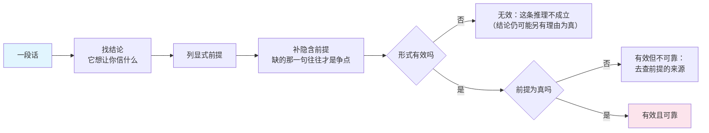

## 概念：逻辑思维

> 逻辑思维是以推理形式的有效性为约束的思考方式。它只回答一个问题：从前提到结论这一步，是否被规则允许。它不回答前提从哪来，也不回答结论值不值得信。

**解决的核心痛点**：把「我觉得」和「必然如此」分开。没有形式约束时，论证的强度只能靠语气、自信度和重复次数来感知，而这三样与真假无关。

### 核心命题

- 三种推理形式的信息流向相反，风险方向也相反
	- **原理**：演绎从一般到个别，结论弱于前提（结论已蕴含在前提里，只把隐含的变显式），不产生新信息但保真；归纳从个别到一般，结论强于前提，产生新信息但被单个反例就能推翻；类比跨域搬运，既不增也不减，只提供假设。**想要新结论和想要可靠性，不可能同时最大化**
- 形式有效与结论为真是两件事，中间隔着一个前提
	- **原理**：有效性只保证「若前提真则结论真」。前提为假的论证可以完全有效——这是「逻辑严密」的错误结论能够大行其道的全部原因，也是「讲逻辑」最常见的误用
- 逻辑不生产前提，只检验这一步
	- **原理**：前提来自测量、经验、公理或权威，都是逻辑之外的来源。「这个论证没有漏洞」能说明的范围，比它听起来小得多：它只说明这一步的传递没错
- 可靠性沿链条相乘，链越长越不可信
	- **原理**：十步各自 90% 的推理串起来只剩 35%（0.9 的十次方约 0.35）。长链论证的问题通常不在某一步错，在算术——所以长链的正确用法是找出最脆弱的一步去验证，而不是把整条链当结论

### 运行机制

论证重构四步：找结论 → 列显式前提 → 补隐含前提 → 检验形式。第三步是产量最高的一步，也是几乎所有人跳过的一步。

三种推理形式的对照，重点是最后一行的失效方式——它们错的地方不一样：

| | 演绎 | 归纳 | 类比 |
|:--|:--|:--|:--|
| 方向 | 一般 → 个别 | 个别 → 一般 | 此域 → 彼域 |
| 结论强度 | 必然 | 概率 | 假设 |
| 信息 | 不增，只显式化 | 增 | 搬运 |
| 反例意味着 | 前提有假 | 结论被推翻 | 相似性选错了维度 |
| 典型失效 | 前提假而形式对 | 样本偏 | 表面相似、机制不同 |

### 关键区别

逻辑思维常被当成批判性思维的同义词，也常被当成线性思维的同义词，两者都不对：

| 维度 | 逻辑思维 | [[批判性思维]] | [[线性思维]] |
|:--|:--|:--|:--|
| 管什么 | 这一步推理是否被允许 | 这个结论值不值得信 | 因果是否单向且可预测 |
| 覆盖范围 | 形式 | 形式 + 前提真伪 + 证据质量 + 动机 | 本体假设 |
| 能发现哪类错 | 推不出来 | 不该信 | 反馈被忽略 |
| 管不到什么 | 前提从哪来 | 不产生方案 | 推理形式 |

表里最要紧的是第三列：线性思维与逻辑思维是正交的——一个完全有效的演绎可以描述一个带反馈回路的系统，一条线性因果链也可以是纯粹的类比。所以「用逻辑思考」不能替代「换一种本体假设」。

另有一组对立被夸大了：逻辑与直觉。直觉是压缩后的模式匹配，输出快而不可解释；逻辑的作用是验收直觉的输出，而不是替代它。没有直觉的逻辑会穷举一切，没有逻辑的直觉无法纠错。

### 适用范围

- ✅ **适用场景**
	- **写论证**：方案、RFC、评审意见里每一处「因为……所以……」，尤其是省略了中间那一步的地方
	- **排错**：把「应该是缓存的问题」拆成前提与检验，避免结论先行之后倒推证据
	- **读别人的论证**：补隐含前提是单位时间收益最高的动作，多数争论在这一步就散了
- ⛔ **误用**
	- **形式正确即正确**：用有效性给假前提背书，是最常见也最难自觉的一种
	- **过度形式化**：把「今晚吃什么」写成三段论，成本远超它避免的错误
	- **向归纳要求必然性**：要求经验结论达到演绎的强度，等于要求它不产生新信息
- **失效边界**
	- **前提的来源问题它管不了**：那是测量、实验与经验的领域
	- **自然语言的论证很少完整形式化**：识别结构本身就有歧义，被漏掉的隐含前提可能才是真正的争点
	- **概率与因果推断超出经典演绎的覆盖**：涉及「多大概率」「是不是因果」时，需要统计与因果推断工具，三段论装不下

### 批判

- **外部批判**
	- 非形式逻辑与论证理论：真实论证的合理性不只看形式，还看语境、听众与举证责任。图尔敏模型把「保证」与「支撑」分开，正是一般三段论装不下的那部分
	- 认知科学：人在实际决策中用的是快速启发式，形式逻辑更像事后整理，而不是思考的实际过程。把逻辑思维当成人脑的工作方式，是一个描述性的错误
- **内在张力**
	- 越严格越无用：形式化程度越高，能装进去的真实问题越少。它在「可检验」与「可用」之间没有稳定解，只能按决策代价临时选点

### 知识图谱

- **上位**：[[思维方式]] — 它只占推理这一轴，不涉及本体假设与工序
- **下位**：
	- [[类比思维]] — 跨域搬运：产生假设，不产生证明
	- [[第一性原理]] — 把前提压到不可再拆再演绎的极端形式
- **并列**：
	- [[批判性思维]] — 同样做检验，但检验的是结论的可信度而非这一步的合法性
- **相关**：
	- [[线性思维]] — 正交：它约束本体假设，不约束推理形式
	- [[逻辑学]] — 形式规范本身的学科
	- [[奥卡姆剃刀]] — 不是逻辑规则，是选前提时的偏好
- **外部资料**
	- 《逻辑学导论》（Irving Copi）— 三段论与谓词逻辑的标准教材，形式有效性的判据以此为准
	- 图尔敏《论证的使用》— 论证结构在真实语境中如何展开
