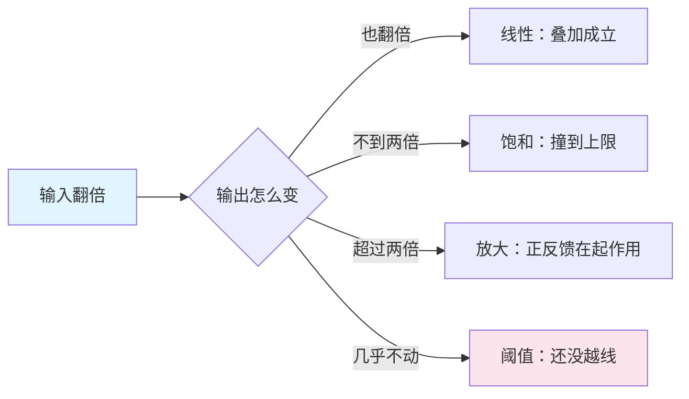

## 概念：非线性思维

> 非线性思维是在叠加原理失效的地方思考：整体不等于部分之和，投入翻倍不带来产出翻倍，越过某个点之后系统会换一种行为方式。它精确的含义不是「不按直线想」，而是「不能把结果拆成各部分的贡献相加」。

**解决的核心痛点**：线性外推在阈值、饱和、正反馈面前会系统性失效，而这三类结构恰好覆盖了大多数真正重要的决策——容量、增长、风险。

### 核心命题

- 非线性的判据是叠加原理失效，不是「图形不是直线」
	- **原理**：可判定的定义只有一条：f(a + b) ≠ f(a) + f(b)。「不像直线」不可判定，所以「这很非线性」在讨论中通常只表示「我觉得复杂」，既没法验证也没法据此行动
- 线性与非线性是扰动幅度的函数，不是系统的固有属性
	- **原理**：光滑函数在局部可用一阶泰勒项近似，误差项是曲率乘扰动幅度的平方。同一个系统，小扰动下线性模型够用，大扰动下必须换非线性模型。把「非线性」当成系统的标签，会让人误以为它始终不可预测
- 常见的非线性只有三种形态，识别形态比识别「非线性」有用
	- **原理**：阈值（越线才响应）、放大（正反馈、指数、复利）、饱和（上限、拥堵）。三者的干预方式完全不同：阈值要找准位置，放大要尽早介入，饱和只能换约束。只知道「这里非线性」什么也做不了
- 长期轨迹对初值敏感，但行为类型由结构决定
	- **原理**：初值差一点，轨迹会分岔得很远（混沌）；但同样的结构，参数怎么调，行为类型不变——阈值还是阈值，饱和还是饱和。所以对策是改结构，不是精调参数

### 运行机制

一个几乎零成本的判别实验：把输入翻倍，看输出怎么变。

四种结果对应四种干预方式：

| 形态 | 数学特征 | 常见表现 | 干预点 |
|:--|:--|:--|:--|
| 阈值 | 阶跃、相变 | 临界规模、审批线、熔点 | 找位置：把资源压到越线前一步，不要均摊 |
| 放大 | 正反馈、指数、复利 | 病毒传播、技术债、口碑 | 早介入：介入成本随时间是同一条指数曲线 |
| 饱和 | 上限、logistic、拥堵 | 容量、注意力、道路通行 | 换约束：继续加投入不再有产出，只能改结构 |
| 混沌 | 对初值指数敏感 | 天气预报、长期预测 | 放弃点预测：给分布，加冗余，缩短反馈周期 |

这张表里最容易被忽略的是「饱和」：多数团队的默认动作是加资源，而饱和区里加资源只会把成本推上去、把产出推平。判断自己是不是在饱和区，看边际产出——它已经连续几轮低于新投入的单位成本。

### 关键区别

三个词经常混着用，实际指三件不同的事：

| | 非线性 | [[系统思维]] | 复杂 |
|:--|:--|:--|:--|
| 是什么 | 数学性质：叠加失效 | 一种看整体的方法 | 系统的一种属性：大量主体 + 局部交互 |
| 判据 | f(a + b) ≠ f(a) + f(b) | 是否画出回路与延迟 | 是否有涌现、无中心控制 |
| 关系 | 系统常常非线性，但线性系统也可以是系统 | 能处理线性系统 | 复杂系统必然非线性 |

关键在最后一行：非线性是性质，系统思维是方法，两者不能互相替代。一个可以用线性方程描述的系统，照样值得画出回路来看延迟；一个明显的非线性系统，不画回路也照样看不出该动哪里。

### 适用范围

- ✅ **适用场景**
	- **容量规划**：判断自己在曲线的哪一段，比算出精确的最优点更有用
	- **增长策略**：找正反馈，而不是把线性的投入产出比当计划依据
	- **风险定价**：尾部风险天生属于阈值与放大区，用均值思维定价必然低估
- ⛔ **误用**
	- **把「非线性」当免责声明**：「太复杂了没法预测」——多数业务问题的扰动幅度小到线性模型足够，先做那个翻倍实验再说
	- **在局部线性区硬套非线性模型**：参数估不出来，结果比线性模型更差
	- **只识别形态不给干预**：说一句「这是指数增长」而不说现在该做什么，等于没说
- **失效边界**
	- **混沌区里任何模型都只给分布，不给点预测**：此时正确的动作不是换更强的模型，而是降低对预测的依赖——加冗余、缩短反馈周期、把不可逆的决策拆成可逆的几步
	- **它不解释形态从哪来**：那要回到结构，谁和谁相连、延迟多长、有没有旁路

### 批判

- **外部批判**
	- 混沌与复杂性研究内部也没有统一的判据，「非线性」在通俗写作里长期被当成「不可预测」的同义词，这是误用——一个确定的非线性系统可以完全可预测
	- 社会与管理领域常借「非线性」论证干预无效，但从性质推不出「不该干预」，只能推出「干预结果不能线性外推」
- **内在张力**
	- 判据 f(a + b) ≠ f(a) + f(b) 可判定，但要测它得先有可测的输入输出。管理与社会领域往往连「把输入翻倍」这个实验都做不了，判据于是退化成类比——这是这套方法最难补的一处缺口

### 知识图谱

- **上位**：[[思维方式]] — 本体轴上的一个取值
- **下位**：
	- 阈值 — 越线才响应，判据是阶跃
	- 正反馈放大 — 输出放大输入，判据是超过线性
	- 饱和 — 撞上限，判据是边际产出递减
- **并列**：
	- [[线性思维]] — 同一轴上取「叠加成立」，是扰动幅度趋零的极限情形
	- [[系统思维]] — 同一条问题的另一条进路：看结构而非看曲率
- **相关**：
	- [[因果链]] — 链条写法隐含「每一步成比例」，非线性处正是它断掉的地方
	- [[第一性原理]] — 从物理约束算出的下界常常是线性的，不能直接外推到规模
- **外部资料**
	- 《非线性动力学与混沌》（Strogatz）— 判据与形态的标准来源
	- 《系统之美》（Meadows）— 回路、延迟与杠杆点的通俗版本
