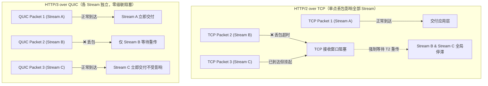

## 命题：HTTP3基于QUIC协议消除传输层队头阻塞

> **核心洞见**：HTTP/2 虽然在应用层实现了基于帧的多路复用（解决应用层 HOL），但受限于底层单条 TCP 连接的有序字节流语义，单分段丢包仍会导致整条连接全 Stream 阻塞；**HTTP/3 底层改用基于 UDP 的 QUIC 协议，在传输层原生实现了每个 Stream 独立的 Packet 编号与独立滑动窗口，解除了各流之间的~~物理级联依赖~~**——注意这是把阻塞从整条连接收缩到单个流，不是消除全部阻塞，见 [[QUIC只缩小阻塞粒度而不消除单流内的有序等待]]。

### 原理解析

#### 1. 为什么 HTTP/2 的多路复用无法彻底消除队头阻塞？

* **TCP 的黑盒字节流语义**：TCP 仅保证"单条连接上按序无差错交付字节流"，它无法感知上层 HTTP/2 的 Stream 概念。
* **级联受阻机制**：
	* 当多个 HTTP/2 Stream 并发复用同一个 TCP 连接时，若 Stream A 的一个 TCP 分节（TCP Packet）在弱网丢包，TCP 接收端缓冲区会因等待该分节重传而停止向上层应用交付后续所有数据（即使属于 Stream B、C 的分节已经完整到达）。
	* **结论**：HTTP/2 在 1%~2% 的轻微丢包弱网环境下，实际吞吐性能与并发表现甚至会显著劣于多条独立的 HTTP/1.1 TCP 连接。

#### 2. QUIC 在传输层切断级联的关键设计

* **独立 Stream 级偏移量（Offset）与独立滑动窗口**：
	* 每个 QUIC Packet 由 `Stream ID` + `Offset` 构成。
	* 某个 Stream 丢包仅会导致该 `Stream ID` 的局部 Offset 暂停组装，其他 Stream 的 Offset 只要连续即可直接交付应用层解析。

### 边界：不是所有网络都通 UDP

* **UDP 封锁与中间件渗透性问题（NAT/防火墙阻断）**：
	* 企业级防火墙或老旧运营商网关可能针对 UDP 80/443 端口配置了 QoS 限速或直接丢弃策略，导致 HTTP/3 连接失败，必须保留优雅降级至 TCP HTTP/2 的回退机制（Alt-Svc 协商机制）。
	* 这一条依附于「HTTP/3 跑在 UDP 上」这个前提，脱离主命题就没有意义，所以留在本篇而不单独成篇。

### 拆分说明

本篇原本 2401 字、夹着四个彼此独立的命题。按 [[原子笔记拆分标准]] 拆出三条，各自成篇：

- [[QUIC的PacketNumber单调递增消除了重传歧义]] —— 讲的是 RTT 测量精度，与阻塞无关
- [[QUIC只缩小阻塞粒度而不消除单流内的有序等待]] —— 本篇做到的和没做到的
- [[用户态QUIC在高并发下的CPU开销高于内核TCP]] —— 部署代价，关心成本的人会单独搜它

留下的部分只回答一个问题：**HTTP/2 的阻塞是怎么被切断的**。

### 关联概念网络

* **支撑概念**：
	* [[队头阻塞]] — 从 HTTP/1.0 管道化到 HTTP/2 TCP 层的核心性能瓶颈
	* [[QUIC]] — 基于 UDP 实现的可靠传输与 TLS 1.3 内嵌握手协议
	* [[多路复用 Multiplexing]] — 单连接复用多请求响应通道的技术实现
* **衍生与应用**：
	* [[0-RTT连接建立与连接迁移机制]] — QUIC 基于 Connection ID 实现的无线弱网快速漫游
	* [[SOP-Web服务器开启HTTP3与Alt-Svc降级配置]] — Nginx 1.25+ 部署 QUIC/HTTP3 的工业级 SOP
