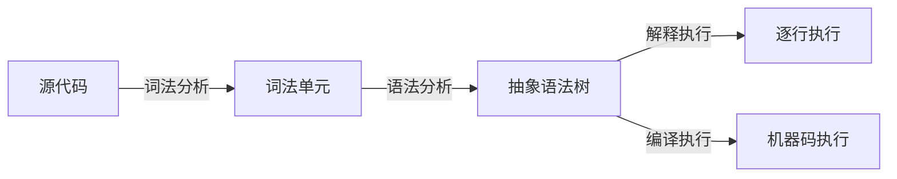

> JavaScript 引擎读取源代码，通过词法分析、语法分析生成抽象语法树 (AST)，然后~~解释执行~~或~~编译执行~~。

**边界**：现代引擎的核心早已不是「解释执行」，而是分层编译与优化/去优化的循环。用「解释 + 执行」描述它，解释不了为什么同一段代码热身后能快几十倍。

## 论据/示例

1. **解析 (Parsing)**：词法分析 + 语法分析 → 生成 AST
2. **解释/编译**：AST → 字节码或机器码
3. **执行**：在虚拟机或直接执行机器码

## 关联

- **父级**：[[JavaScript 引擎]]
- **相关**：[[V8 引擎]] [[字节码]]
