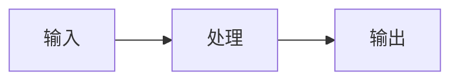

<!--
	概念笔记 (Concept Note) 设计原则：

	1. 概念笔记用于记录需要系统性理解的复杂主题
	2. 核心是"核心命题"——用陈述句表达你对概念的洞见
	3. 核心命题应该引用 atomic 笔记（陈述句观点），而非 term（术语定义）
	4. 知识图谱只用五个桶：上位 / 下位 / 并列 / 相关 / 外部资料，不造同义变体
	5. 包含运行机制的可视化（Mermaid 代码）
	6. 「问题与流程」一节收两类出口：未收敛的 Question 与已收敛的 SOP
	7. 没有内容的章节整节删除，不留「（暂无，待补充）」——那种占位没人会回头填

	写作节奏：
	- 先写核心定义（What）
	- 再写核心命题（Why/How）- 引用 atomic 观点
	- 最后写适用范围（When/Where）与「问题与流程」（How to do / What's the problem）

	章节顺序：
	概念定义 → 核心命题 → 运行机制 → 关键区别 → 适用范围 → 批判 → 问题与流程 → 知识图谱

	本模板真值来源：[[笔记类型规范]]
-->

## 概念：{{概念名称}}

> {{概念一句话定义}}

**解决的核心痛点**：{{该概念是为了解决什么具体问题而诞生的？}}

### 核心命题

> 核心命题引用 atomic 笔记（陈述句观点），每个命题是一句话洞见

- [[{{atomic笔记标题（陈述句观点）}}]]
	- **原理**：{{简述}}
- [[{{另一个atomic笔记标题}}]]
	- **原理**：{{简述}}

### 运行机制

{{描述机制，或插入 Mermaid 代码}}

### 关键区别

{{本概念和相似概念的关键区别}}

| 维度 | {{本概念}} | [[{{易混淆概念}}]] |
|:--- |:--- |:--- |
| **核心逻辑** | … | … |
| **适用场景** | … | … |

### 适用范围

- ✅ **适用场景**
	- **{{场景 1}}**：{{理由}}
- ⛔ **误用**
	- **{{反模式}}**：{{为什么这样用是错的}}
- **失效边界**
	- {{这个概念自身无法解释什么？在哪些领域不具解释力？}}

### 批判

- **外部批判**
	- {{学派/人物}}：{{核心批判点}}
	- {{学派/人物}}：{{核心批判点}}
- **内在张力**
	- {{概念内部的自洽性问题或未解决的困境}}

### 问题与流程

> 本概念向下延伸的两类出口：还没收敛的问题（Q）与已经收敛的流程（SOP）。前者发散、后者是同一批问题的收敛产物，放在一节里才看得出对应关系。
> **没有相关 Q 或 SOP 时整节删除**，不要留「（暂无，待补充）」。

- **相关问题**
	- [[{{相关问题1}}]] — {{它卡在哪一步}}
- **相关流程**
	- [[{{本概念相关SOP}}]] — {{这条流程解决什么}}

### 知识图谱

> 固定五个桶：**上位 / 下位 / 并列 / 相关 / 外部资料**，判据与来源见 [[知识图谱词表]]。这是全库唯一的一套关系词表——「父级概念」「母领域」「关联概念」「参考来源」这类同义写法已在 2026-10-27 收口（当时 70 种写法、834 次出现），不要再长出来。
> 没有内容的桶整行删掉，不要留「（暂无）」。

- **上位**：[[{{上位概念}}]] — 它比本概念更概括在哪
- **下位**：
	- [[{{下位概念}}]] — 它比本概念更具体在哪
- **并列**：
	- [[{{并列概念}}]] — 同级但不同侧面
- **相关**：
	- [[{{相关概念}}]] — 相关在哪一步
- **外部资料**
	- {{文章/文献链接}}