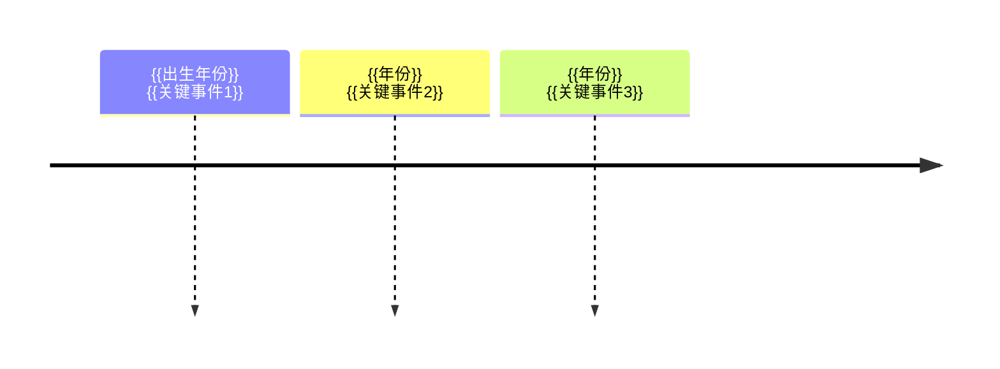

<!-- 判据:begin 由 _scripts/sync_criteria.py 从登记条目生成，勿手改 -->
	子模板，不映射独立类型；判据随父模板 `template_record` 走。
	- [[E17 注记与 atomic：可反驳 vs 可核实|E17]] 注记与 atomic：可反驳 vs 可核实
	通用判据与写作速查见 [[判据速查]]。
<!-- 判据:end -->

<!--
	记录的人物形态（Record / 人物）设计原则：

	1. 这是 record 的子模板，content-type 仍是 `record`。**人物是题材不是形态**——
	   它与「记事」的唯一区别是记的内容，不是写法，按「不按题材划分类型」（P16）
	   不构成独立类型。2026-11-09 由 `person` 并入，模板保留、类型取消。
	2. 记的是「这个人是谁、想过什么」，不是「我从他那里消费什么」。后者是信源卡
	   （`template_source.md`）；同一个人可以两张都有，分工见 [[笔记类型规范#record 的五种形态]]。
	3. 核心是生平 + 思想：客观生平写正文，观点只挂 [[atomic]] / [[concept]] 链接，不在这里展开。
	4. **生卒、国籍、职业写「人物卡片」表格，不进 frontmatter。** 表格读正文时就在眼前，
	   字段再存一份等于两处维护，两处不一致还不报错。四个字段已进 [[元数据规范#字段墓碑]]。

	命名规范：aliases 用 `R-{{人物姓名}}`（与 record / roadmap 共享 R- 前缀）

	章节顺序：
	人物卡片 → 生平简介 → 人生时间线 → 主要成就 → 思想与观点 → 代表作品 → 关系网络 → 名言 → 评价与争议 → 知识图谱

	设计判据：[[类型设计判据]]；形态定义：[[笔记类型规范#record 的五种形态]]
-->

> {{人物一句话概述}}

## 人物卡片

| 项目 | 信息 |
|------|------|
| **姓名** | {{姓名}} |
| **生卒** | {{生卒年月}} |
| **国籍** | {{国籍}} |
| **职业** | {{职业/身份}} |
| **代表领域** | {{领域}} |

### 生平简介

{{人物生平概述，按时间分阶段叙述}}

### 人生时间线

| 时间 | 事件 | 影响 |
|------|------|------|
| {{年份}} | {{事件}} | {{影响}} |

### 主要成就

- **{{成就1}}**：{{内容与影响}}
- **{{成就2}}**：{{内容与影响}}

### 思想与观点

> 提炼人物的核心思想，链接到相关 atomic/concept 笔记

- [[{{思想观点1}}]] — {{简述}}
- [[{{思想观点2}}]] — {{简述}}

### 代表作品

- **{{作品1}}**（{{年份}}）：{{简介}}
- **{{作品2}}**（{{年份}}）：{{简介}}

### 关系网络

- **师承**：[[{{老师}}]] — {{关系说明}}
- **同侪**：[[{{同侪}}]] — {{关系说明}}
- **影响者**：[[{{影响过TA的人}}]] — {{关系说明}}
- **被影响者**：[[{{受TA影响的人}}]] — {{关系说明}}

### 名言

> {{名言1}} —— {{出处/年份}}
>
> {{名言2}} —— {{出处/年份}}

### 评价与争议

- **正面评价**：{{评价}}
- **争议**：{{争议点}}

### 知识图谱

> 与 concept 共用同一套五个桶（上位 / 下位 / 并列 / 相关 / 外部资料），判据见 [[知识图谱词表]]。人物不是概念，但关系词表不另起一套——「相关人物」「参考来源」这类写法已随 2026-10-27 的收口并入「相关」与「外部资料」。

- **上位**：[[{{所属领域}}]] — 这个人在哪个领域活动
- **相关**：
	- [[{{概念A}}]] — {{关联说明}}
	- [[{{人物A}}]] — {{关联说明}}
- **外部资料**
	- {{文献/文章链接}}
