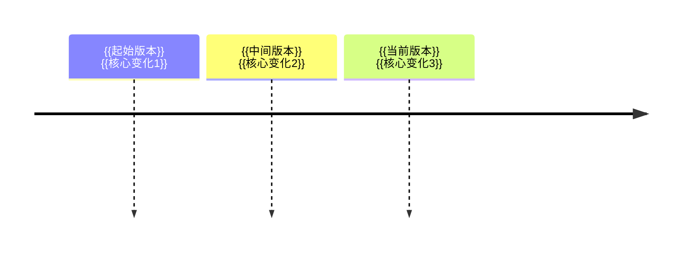

<!--
	路线图笔记 (Roadmap Note) 设计原则：

	1. 用于记录线性演进历程：版本迭代、技术发展、时间线等
	2. 核心是"演进阶段"——按时间/版本顺序记录关键变化
	3. 每个阶段包含：版本号/时间点、核心变化、解决的关键问题
	4. 包含可视化时间线（Mermaid timeline 或 gantt）
	5. 每个阶段标注涉及的笔记——「涉及」不是关系桶，关系只写在末尾「知识图谱」一节

	章节顺序：
	定义 → 演进概览 → 阶段详情 → 时间线 → 关键转折点 → 未来展望 → 知识图谱
  本模板真值来源：[[笔记类型规范]]
-->

## {{主题}}演进

> {{一句话概括演进历程的核心}}

**时间跨度**：{{起始版本/时间}} → {{当前版本/时间}}
**演进动力**：{{驱动演进的根本原因}}

### 演进概览

### 阶段详情

#### {{版本A/阶段A}}

- **时间**：{{版本发布时间或阶段时间}}
- **核心变化**：{{主要更新内容}}
- **解决的关键问题**：{{这个版本解决了什么问题}}
- **涉及**：[[{{相关概念A}}]] [[{{相关概念B}}]]

#### {{版本B/阶段B}}

- **时间**：{{版本发布时间或阶段时间}}
- **核心变化**：{{主要更新内容}}
- **解决的关键问题**：{{这个版本解决了什么问题}}
- **涉及**：[[{{相关概念A}}]] [[{{相关概念B}}]]

#### {{版本C/阶段C}}

- **时间**：{{版本发布时间或阶段时间}}
- **核心变化**：{{主要更新内容}}
- **解决的关键问题**：{{这个版本解决了什么问题}}
- **涉及**：[[{{相关概念A}}]] [[{{相关概念B}}]]

### 关键转折点

> 演进中的重要里程碑或范式转换

| 时间点 | 转折内容 | 影响 |
|:---|:---|:---|
| {{版本/时间}} | {{转折事件}} | {{带来的变化}} |

### 未来展望

- **趋势**：{{未来可能的方向}}
- **待解决**：{{仍有待解决的问题}}
- **值得关注**：{{值得跟踪的新方向}}

### 知识图谱

> 桶名从这五个里取：上位 / 下位 / 并列 / 相关 / 外部资料，判据见 [[知识图谱词表]]；用不上的整行删掉，不留「（暂无）」。
> 演进线本身是一条时间线，所以它的 `并列` 是**同类的其他演进线**，不是这条线上的某个版本——版本是本文的章节，不是关系。

- **上位**：[[{{所属领域}}]] — 这条演进线属于哪个领域
- **并列**：
	- [[{{另一条演进线}}]] — 同一层级的另一条线
- **相关**：
	- [[{{概念A}}]] — 关联在哪一步
	- [[{{概念B}}]] — 关联在哪一步
- **外部资料**
	- {{发布日志 / 官方博客链接}}