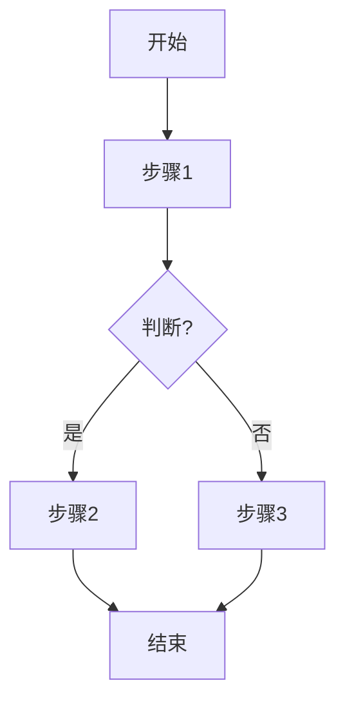

<!--
	SOP 设计原则：

	1. SOP指的是Standard Operating Procedure（标准化作业流程）
	2. 核心是标准化（目标、实现步骤、实践示例）、边界条件（适用场景、常见坑点）
	3. 撰写流程：先确定目标和适用场景，然后写实现步骤并画流程图，最后总结坑点

	可信度原则（2026-10-26 增）：

	4. 结构齐不等于可信。步骤、坑点、流程图谁都能写——它们出自同一次推理，
	   而同源的两次陈述不能互相证伪。示例尤其不算证据：它只是链路的另一种写法。
	5. 可信度落在两处，模板各留了落点：
	   - 跑通了没有 → 「### 验证记录」。空着就是没跑过，这是有效数据，不是待办。
	   - 依赖变了没有 → 「### 目标与边界」的「依赖」「失效条件」。
	   两者里过时更该防：SOP 不报错，它只会在你照着做的时候悄悄错。
	6. 验证记录必须是正文段，不能做成 frontmatter 字段。字段只存一个值，而试跑是累积的；
	   字段在创建那一刻就得填——那时还没跑，只能填「待验证」，之后没人回头改。
	   这是 status 已经踩过的坑。

	视觉化支持：
	- Mermaid图标：流程图形式，展示达到目标的标准流程

	本模板真值来源：[[笔记类型规范]]
-->

## SOP：{{动宾结构标题}}

> 一句话描述这个 SOP 的目标和适用场景
> **问题溯源**：本 SOP 是 [[Q-{{源问题}}]] 的收敛成果。（没有源问题就删掉这一行，不要编一个）

### 目标与边界

**目标**：{{做完之后能指出什么已经改变——写成可观测的终态，不写「掌握」「理解」}}

**依赖**：{{跑通它的前提：工具版本、运行环境、上游必须已存在的产物}}
<!-- 版本锚点必填。写出具体版本号，过时的那一刻才有东西可对照。 -->

**失效条件**：{{什么情况下别用这条链路，或第几步需要改}}

### 适用场景

- 场景 1：{{具体情况}}
- 场景 2：{{具体情况}}

### 流程图解

### 核心步骤

1. **步骤 1**：{{做什么}}
	 - 注意：{{关键点}}
2. **步骤 2**：{{做什么}}
3. **步骤 3**：{{做什么}}

### 实践/示例

{{实践或者代码示例}}
<!-- 示例只说明这条链路长什么样，不说明它跑得通。跑通的证据写进「验证记录」，不要在这里用完成时描述还没发生的事。 -->

### 常见坑点

- ⛔ **反模式**：{{不要做什么}}
- 🔧 **排查**：如果 {{错误}}，检查 {{检查点}}

### 验证记录

<!-- 只写跑过的事实，不写评价。空着 = 这条链路只是推理，没跑通过。
     每跑一次加一行：日期 · 在哪跑的 · 得到什么 · 断在第几步
     断点比成功更有信息量——它说明链路在哪一段最脆。
     例：- 2026-10-26 · W43 周记 · 得到 3 条目标，全部指认不出 project · 断在第 4 步：落点三选一无可选项 -->

### 知识图谱

> 与 concept 共用五个桶（判据见 [[知识图谱词表]]）；`问题来源` 是唯一保留的第六个——它记的是 Q → SOP 的收敛血缘，与「概念之间怎么相关」不是同一个轴，不要并进「相关」。

- **上位**：[[{{所属领域}}]] — 这条流程属于哪个领域
- **相关**：
	- [[{{相关笔记}}]]
	- [[{{相关笔记}}]]
- **问题来源**：[[Q-{{源问题}}]] — 从哪个问题收敛而来
